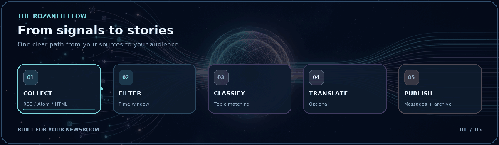
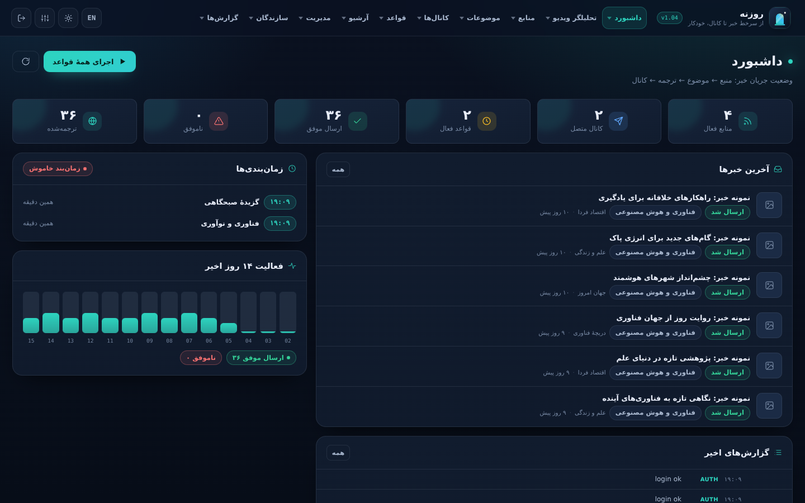
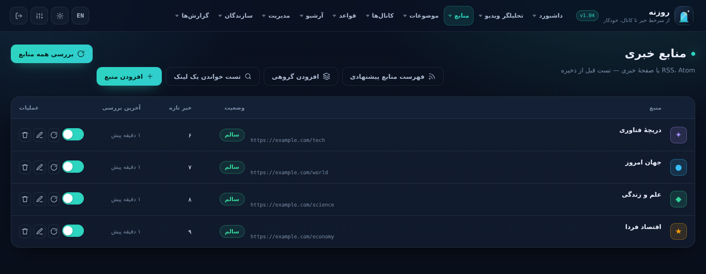
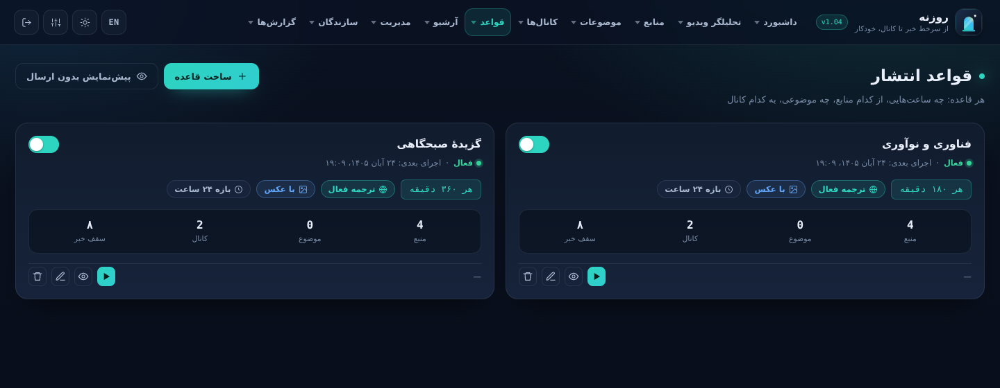
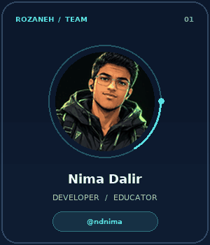
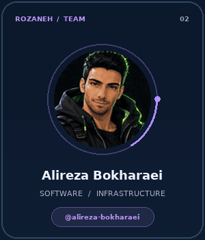
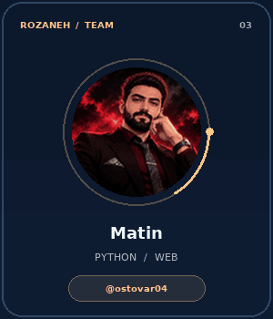

<div align="center">


# روزنه · Rozaneh

### از سرخط خبر تا کانال، خودکار.

**یک اتاق خبر کوچک، برای ایده‌های بزرگ.**<br>منابع خودت را انتخاب کن؛ روزنه خبرها را می‌خواند، مرتب می‌کند و به مخاطبانت می‌رساند.

`Python` &nbsp; · &nbsp; `FastAPI` &nbsp; · &nbsp; `SQLite` &nbsp; · &nbsp; `Docker` &nbsp; · &nbsp; `MIT`

[شروع سریع](#شروع-سریع) &nbsp; ✦ &nbsp; [جریان کار](#جریان-کار) &nbsp; ✦ &nbsp; [نگاهی به پنل](#gallery) &nbsp; ✦ &nbsp; [سازندگان](#سازندگان) &nbsp; ✦ &nbsp; [English](#english-summary)

</div>

---

## روزنه در یک نگاه

روزنه یک پنل متن‌باز برای **جمع‌آوری، دسته‌بندی و انتشار خبر** است. منابع RSS، Atom یا صفحات خبری را در بازه‌های مشخص می‌خواند؛ سپس بر اساس قواعد دلخواهت خبرها را فیلتر، در صورت نیاز ترجمه و به تلگرام، بله، ایتا، روبیکا یا وب‌هوک ارسال می‌کند. در کنار آن، تحلیلگر ویدیو و آرشیو و گزارش‌ها را هم در اختیار داری.

📡 **منابع خودت** · 🎯 **فیلتر موضوعی** · 🌐 **ترجمهٔ اختیاری** · ⏱️ **زمان‌بندی** · 🎬 **تحلیل ویدیو**

> روزنه برای اجرای خودکار به سرور روشن و فضای ذخیره‌سازی دائمی نیاز دارد. قابلیت‌های هوش مصنوعی نیز به مدل، کلید و دسترسی سرویس انتخابی وابسته‌اند.

---

## جریان کار

<div align="center">

</div>

1. **دریافت** — خبرها از منابع انتخابی خوانده می‌شوند.
2. **انتخاب** — بازهٔ زمانی و موضوعات بررسی می‌شوند؛ فیلتر موضوعی قبل از سقف خبر اعمال می‌شود.
3. **آماده‌سازی** — در صورت فعال‌بودن، ترجمه انجام می‌شود و تصویر در دسترس از خود خبر انتخاب می‌شود.
4. **انتشار و پیگیری** — هر خبر به‌صورت جداگانه به مقصدهای انتخاب‌شده ارسال و وضعیت آن در آرشیو و گزارش‌ها ثبت می‌شود. گزینهٔ «فقط خبرهای تازه» از ارسال دوباره جلوگیری می‌کند.

[نمای بدون حرکت](docs/images/workflow-still.png) · [قواعد پیام‌رسان‌ها](#messengers)

---

<a id="gallery"></a>

## اسکرین‌شات‌ها

<div align="center">

**یک نگاه به فضای روزنه**<br>این تصاویر از پنل واقعی و با داده‌های ساختگی گرفته شده‌اند؛ زمان‌بند در محیط نمونه خاموش است.



| منابع خبری | قواعد انتشار |
| :---: | :---: |
|  |  |

[دیدن بقیهٔ تصاویر](docs/shots/)

</div>

---

## امکانات

از تنظیم منابع و انتشار زمان‌بندی‌شده تا تحلیل ویدیو، گزارش‌ها و شخصی‌سازی پنل؛ جزئیات قابلیت‌ها را اینجا باز کن:

<details>
<summary><strong>نمایش قابلیت‌ها و محدودیت‌های مهم</strong></summary>

**منابع خبری**
- افزودن لینک RSS/Atom، صفحهٔ خبری HTML، افزودن گروهی (هر خط یک لینک) و تست لینک **قبل از ذخیره**.
- برای هر لینک: **آیکن، رنگ و نمایش/مخفی‌بودن آدرس** و ترتیب دلخواه (بالا/پایین).
- بررسی تکی یا گروهی سلامت همهٔ منابع (شامل منابع غیرفعال)، تعداد خبرهای تازه و زمان آخرین بررسی؛ اگر RSS نبود، خودکار صفحهٔ HTML خوانده می‌شود. بررسی گروهی تا وقتی صفحه باز است با حداکثر سه درخواست هم‌زمان انجام می‌شود.

**موضوعات**
- ۱۰ موضوع آمادهٔ دوزبانه (سیاست، اقتصاد، ورزش، فناوری، سلامت، محیط زیست، هنر، دانش، بین‌الملل، حوادث) با کلیدواژه‌های فارسی و انگلیسی.
- تطبیق کلیدواژه با وزن (عنوان ۳، خلاصه ۱)، ساخت موضوع جدید و «تست تطبیق» روی یک تیتر.

**قواعد انتشار (Rules)**
- چند ساعت در روز **یا** فاصلهٔ زمانی (هر N دقیقه)، بازهٔ زمانی خبر، سقف خبر در هر اجرا.
- انتخاب منابع، موضوعات و کانال‌های مقصد برای هر قاعده به‌صورت مستقل.
- گزینه‌های ترجمه، ارسال خلاصه، ارسال عکس، «فقط خبرهای تازه» و فعال/خاموش.
- **پیش‌نمایش بدون ارسال (Dry run)** با گزارش کامل و متن دقیق پیام‌ها، و اجرای فوری هر قاعده.

**انتشار**
- پنج مقصد: **تلگرام، بله، ایتا، روبیکا، وب‌هوک** با آیدی عددی کانال + توکن ربات.
- هر خبر = یک پیام مستقل شامل عنوان و، وقتی گزینهٔ «خلاصه» در قاعده روشن است، توضیح کوتاه برگرفته از RSS یا صفحهٔ خود خبر؛ هیچ توضیحی از روی حدس ساخته نمی‌شود. اگر متن در دسترس نباشد، پیام و گزارش این موضوع را اعلام می‌کنند. محدودیت طول کپشن پیام‌رسان رعایت می‌شود.
- عکس از خود خبر انتخاب می‌شود، نه تصویر عمومی صفحهٔ فهرست. عکس‌های قبلاً ارسال‌شده به هر مقصد با آدرس و اثرانگشت فایل بررسی می‌شوند؛ برای تصاویر بصری مشابه، صد تصویر اخیر نیز به‌صورت تقریبی مقایسه می‌شوند. تطبیق بصری قطعی نیست و ممکن است عکسی را اشتباه مشابه تشخیص دهد یا تغییرات زیاد را تشخیص ندهد. اگر تصویر تکراری یا قابل‌دریافت نباشد، همان خبر به‌صورت متنی و در یک پیام ارسال می‌شود. سوابق قدیمی فقط با آدرس ثبت‌شده و مقصدهای موفق بررسی می‌شوند.
- اگر ارسال عکس صریحاً رد شود، خبر به‌صورت متن ارسال می‌شود. در خطاهای مبهم شبکه یا خطای سرور، ارسال مجدد خودکار انجام نمی‌شود تا از دو پیام احتمالی جلوگیری شود؛ وضعیت را در گزارش بررسی کنید.
- امضای سراسری یا امضای اختصاصی هر کانال، و محدودیت طول پیام.

**ترجمه**
- پیش‌فرض **DeepSeek** با کیفیت بالا + سرویس پشتیبان خودکار (Google Translate بدون کلید یا هر API سازگار با OpenAI).
- بازبینی و اصلاح خودکار خروجی، حفظ نام‌ها/اعداد/تاریخ‌ها، واژه‌نامهٔ «ترجمه نشوند» و کش ترجمه.

**تحلیلگر ویدیو**
- لینک یوتیوب/ویمئو/فایل مستقیم یا آپلود فایل را می‌دهی؛ بر اساس داده‌های در دسترس، خلاصه، مشخصات فنی، متن، فریم‌های نمونه، کلیدواژه‌ها، لحن و موضوع برمی‌گردد. همهٔ این داده‌ها برای هر لینک در دسترس نیستند.
- در کارت حالت هوشمند، پروتکل API، آدرس HTTPS، مدل و کلید مستقل را ذخیره و اتصال ذخیره‌شده را تست کنید. سه پروتکل پشتیبانی می‌شوند: **OpenAI-compatible** (از جمله سرویس‌هایی مانند OpenRouter، DeepSeek و Groq با آدرس و مدل مخصوص خودشان)، **Gemini** و **Anthropic Messages**. آدرس پیش‌فرض و مدل را می‌توان ویرایش کرد؛ نام دقیق و دسترسی مدل را از ارائه‌دهنده بگیرید. APIهایی که هیچ‌یک از این قالب‌ها را ندارند نیاز به پیاده‌سازی اختصاصی دارند و صرف واردکردن کلید کافی نیست. هنگام تغییر سرویس یا آدرس، کلید جدید لازم است تا کلید قبلی تصادفاً به سرویس دیگری ارسال نشود.
- لینک یوتیوب همان‌جا به‌صورت دستی اجرا می‌شود و وضعیت خودکار را تغییر نمی‌دهد. با فعال‌بودن خودکار، تحلیل‌های تازه نیز از همین تنظیمات استفاده می‌کنند. اگر کلید جداگانه‌ای تنظیم نشود رفتار قبلی خلاصه‌سازی حفظ می‌شود. سرویس انتخاب‌شده ممکن است هزینه داشته باشد.
- لینک یوتیوب عمومی با `yt-dlp` به جریان تصویری تبدیل می‌شود و `ffmpeg` تا شش فریم نمونه را مستقیم از جریان دریافت می‌کند؛ فایل کامل یوتیوب در حافظه یا دیسک ذخیره نمی‌شود. اگر جریان یا فریم قابل دسترسی نباشد، تحلیل یوتیوب خطا می‌دهد و عنوان را جای ویدیو جا نمی‌زند. برای تفسیر تصاویر باید یک API و مدلِ پشتیبان تصویر تنظیم و گزینهٔ ارسال فریم روشن شود؛ در غیر این صورت فقط فریم‌ها نمایش و خلاصه از متن ساخته می‌شود. این نمونه‌ها تماشای کامل ویدیو نیستند و صوت فقط با زیرنویس عمومی یا متن ورودی تحلیل می‌شود. متن تا ۶۰٬۰۰۰ نویسه نگه داشته می‌شود. محدودیت یوتیوب، منطقه، تغییرات سایت و نیاز به ورود ممکن است مانع دسترسی شود.
- کلید و تنظیمات در دیتابیس محلی برنامه ذخیره می‌شوند؛ کلید در پاسخ تنظیمات و خروجی پشتیبان نمایش داده نمی‌شود، اما در خود SQLite رمزنگاری نشده است. از فایل دیتابیس، دسترسی سرور و نسخه‌های پشتیبان محافظت کنید. متن و فریم‌های انتخاب‌شده به ارائه‌دهندهٔ API ارسال می‌شوند.
- **هیچ محدودیت زمانی کلی ندارد**: تحلیل تا پایان ادامه پیدا می‌کند. وضعیت ارسال فایل با درصد نمایش داده می‌شود؛ ۱۰۰٪ پایان آپلود است، نه پایان تحلیل.
- **حالت دستی**: هر بار که «تحلیل کن» می‌زنی (یا API صدا می‌زنی) فقط همان یک ویدیو تحلیل می‌شود؛ این کار هرگز حالت هوشمند را روشن/خاموش نمی‌کند.
- **حالت هوشمند (خاموش/روشن)**: اگر روشن باشد، زمان‌بند لینک‌های ویدیویی تازهٔ آرشیو را که تا حالا تحلیل نشده‌اند خودکار تحلیل می‌کند (هر N دقیقه، پیش‌فرض ۳۰).
- برای کاهش مصرف منابع، در هر پردازه یک تحلیل در لحظه اجرا می‌شود و درخواست‌های بعدی بدون محدودیت زمانی در صف می‌مانند؛ ffmpeg با یک رشته اجرا می‌شود. فایل‌های آپلودی منتظر در صف تا پایان یا لغو موقتاً روی دیسک می‌مانند؛ هر فایل حداکثر ۲ گیگابایت است و برای حجم فایل و فضای کافی باید برنامه‌ریزی کرد. با چند پردازه/replica هرکدام صف جدا دارند، پس روی سرور کوچک یک پردازه اجرا کنید.
- برای تحلیل تصویری یوتیوب `ffmpeg` ضروری است. فایل‌های MP4 محلی بدون آن همچنان می‌توانند مشخصات و خلاصهٔ متنی داشته باشند. وابستگی‌های `yt-dlp` و Deno هنگام نصب پایتون دریافت می‌شوند؛ آن‌ها موقتاً برای حل پخش اجرا می‌شوند و فضای نصب و مصرف حافظه دارند.

**پنل**
- **دوزبانه (فارسی RTL / انگلیسی LTR)** با سوییچ فوری زبان — همهٔ نوشته‌ها، تاریخ‌ها و اعداد بومی‌سازی می‌شوند.
- **چهار تم**: طوسی، کهربایی و سفید، شفق بنفش و اقیانوس — انتخاب کاربر در تنظیمات ذخیره می‌شود.
- ناوبری افقی با زیرمنوهای انیمیشنی (هاور در دسکتاپ) و منوی همبرگری در موبایل.
- داشبورد با آمار، نمودار ۱۴ روز اخیر، زمان‌بندی‌های بعدی، آخرین خبرها و گزارش‌ها.
- صفحهٔ مستقل رویدادهای ثبت‌شده با جست‌وجو و فیلتر سطح؛ ۳۰۰ رویداد آخر نمایش داده و حداکثر ۳۰۰۰ رویداد نگهداری می‌شود. این بخش جایگزین لاگ کامل سرور نیست.
- آرشیو کامل با وضعیت (ارسال‌شده / ناموفق / فیلترشده)، جست‌وجو، پیش‌نمایش و **ارسال مجدد**.
- بخش **مدیریت**: تغییر ظاهر و ترتیب لینک‌ها، تم/زبان/منطقهٔ زمانی، خروجی/بازیابی JSON، پاک‌سازی آرشیو، مدیریت نشست‌ها و رمز عبور.
- بخش **سازندگان** و **ارتباط با ما** (پیام‌ها در گزارش‌ها ثبت و در صورت تنظیم، به وب‌هوک شما ارسال می‌شوند).

</details>

---

## سازندگان

<div align="center">

**سه نگاه، یک ایده: روزنه**<br>آشنایی با تیمی که پشت این پروژه ایستاده است.

<a href="https://github.com/ndnima"></a> <a href="https://github.com/alireza-bokharaei"></a> <a href="https://github.com/ostovar04"></a>

[نیما دلیر](https://github.com/ndnima) &nbsp; · &nbsp; [علیرضا بخارائی](https://github.com/alireza-bokharaei) &nbsp; · &nbsp; [متین](https://github.com/ostovar04)

</div>

---

## شروع سریع

> **پیش از انتشار عمومی:** دیتابیس، نشست‌ها، کلیدها و توکن‌ها را هرگز در Git قرار ندهید. این مخزن در وضعیت فعلی شامل `data/rozaneh.db` ردیابی‌شده است؛ `.gitignore` فایل‌های از قبل ردیابی‌شده یا تاریخچه را پاک نمی‌کند. پیش از عمومی‌کردن، از داده‌ها پشتیبان بگیرید، توکن‌های افشاشده را تعویض کنید و با هماهنگی همهٔ همکاران فایل و تاریخچه را پاک‌سازی کنید. حذف فایل از آخرین commit به‌تنهایی تاریخچه را پاک نمی‌کند.

> گام‌به‌گامِ گیت‌هاب + Railway + تست واقعی کانال و راهنمای Shiprr در [`docs/DEPLOY.md`](docs/DEPLOY.md) آمده است. **Shiprr دیسک دائمی ندارد** و پایگاه SQLite محلی روزنه ممکن است با استقرار مجدد پاک شود؛ برای نگه‌داری داده‌ها میزبانی با دیسک دائمی انتخاب کنید.

### ۱) Railway (پیشنهادی)

1. ریپو را **Fork** کنید.
2. در Railway: `New Project → Deploy from GitHub repo` و همین ریپو را انتخاب کنید.
3. یک **Volume** بسازید و آن را به مسیر `/data` وصل کنید (دیتابیس اینجا می‌ماند).
4. در `Variables` این‌ها را بگذارید:

   | کلید | مقدار نمونه |
   | --- | --- |
   | `DATA_DIR` | `/data` |
   | `ADMIN_PASSWORD` | یک رمز قوی دلخواه |
   | `DEFAULT_TZ` | `Asia/Tehran` |
   | `COOKIE_SECURE` | `1` |

5. `Settings → Networking → Generate Domain` را بزنید و پنل را باز کنید.
6. سلامت سرویس: `GET /healthz` → `{"ok":true,"app":"Rozaneh","version":"1.04"}`

### ۲) Docker

```bash
docker build -t rozaneh .
docker run -d --name rozaneh -p 8080:8080 \
  -v rozaneh-data:/data \
  -e ADMIN_PASSWORD='یک-رمز-قوی' \
  -e DEFAULT_TZ=Asia/Tehran \
  rozaneh
```

### ۳) VPS (Ubuntu/Debian)

```bash
curl -fsSL https://raw.githubusercontent.com/ndnimanima/akhbar/main/start.sh | sudo bash
```

اسکریپت پایتون و FFmpeg را نصب می‌کند، محیط مجازی و سرویس `systemd` می‌سازد و رمز اولیه را چاپ می‌کند. قبل از اجرا و به‌روزرسانی از اطلاعات پشتیبان بگیرید و اسکریپت را بررسی کنید؛ در صورت تغییرات محلی یا مسیر غیرخالی غیر Git، اسکریپت متوقف می‌شود. سرویس پیش‌فرض با کاربر root و HTTP اجرا می‌شود؛ برای محیط عمومی حساب محدود و HTTPS با reverse proxy تنظیم کنید.

### ۴) اجرای محلی

```bash
cp .env.example .env
python -m venv .venv && source .venv/bin/activate
pip install -r requirements.txt
uvicorn app.main:app --reload --port 8080
# → http://127.0.0.1:8080
```

رمز اولین ورود همان `ADMIN_PASSWORD` است (پیش‌فرض: `rozaneh`). **بعد از اولین ورود از «تنظیمات → امنیت» رمز را عوض کنید.**

---

## مصرف منابع

- بررسی‌های هم‌زمانِ یک آدرس منبع، دریافت شبکه را مشترک انجام می‌دهند. بررسی بعدی همچنان با منبع تماس می‌گیرد؛ اگر سرور `ETag` یا `Last-Modified` بدهد و تغییرنکردن را با `304` تأیید کند، دانلود و پردازش دوبارهٔ محتوا لازم نیست. این روش به پشتیبانی و پاسخ صحیح سرور منبع بستگی دارد و تعداد درخواست‌های غیرهم‌زمان را کم نمی‌کند. حافظهٔ موقت فقط در هر پردازه است و حداکثر ۱۶ منبع، هرکدام تا ۱۲۸ کیلوبایت دادهٔ پردازش‌شده نگه می‌دارد.
- تصویری که طبق سوابق برای یک مقصد تکراری است برای آن مقصد دوباره دانلود یا ارسال نمی‌شود؛ خبر همچنان به‌صورت متن ارسال می‌شود. اگر مقصد دیگری به تصویر نیاز داشته باشد، تصویر دریافت می‌شود. ترجمه‌های موفق نیز از قبل در SQLite ذخیره و برای متن و تنظیمات یکسان استفاده می‌شوند.
- این موارد مصرف را بر اساس الگوی استفاده کم می‌کنند، نه با حذف خبر یا افزایش فاصلهٔ زمان‌بند. تعداد درخواست به پیام‌رسان و مصرف ویدیو یا مدل هوش مصنوعی همچنان به حجم کار وابسته است.

---

## متغیرهای محیطی

| متغیر | پیش‌فرض | توضیح |
| --- | --- | --- |
| `ADMIN_PASSWORD` | `rozaneh` | رمز اولین بوت؛ پس از تغییر در پنل، هش PBKDF2 ذخیره می‌شود. |
| `DATA_DIR` | `./data` | پوشهٔ دیتابیس SQLite (`rozaneh.db`). روی Railway: `/data`. |
| `DEFAULT_TZ` | `Asia/Tehran` | منطقهٔ زمانی زمان‌بند (ساعت‌های قواعد بر همین اساس است). |
| `PORT` | `8080` | پورت HTTP. |
| `COOKIE_SECURE` | `0` | اگر پنل روی HTTPS است، `1` بگذارید. |
| `SCHEDULER_ENABLED` | `1` | `0` = فقط اجرای دستی. |
| `HTTP_TIMEOUT` | `20` | مهلت درخواست‌های خروجی (ثانیه). |
| `SEND_DELAY` | `0.8` | فاصلهٔ بین دو ارسال (ثانیه) برای رعایت محدودیت ربات‌ها. |

کلیدهای ترجمه (`DeepSeek API key` و …) در پنل → تنظیمات → ترجمه ذخیره می‌شوند و در خروجی پشتیبان قرار نمی‌گیرند.

---

<a id="messengers"></a>

## کانال‌ها و پیام‌رسان‌ها

روزنه با API رسمی هر چهار پیام‌رسان حرف می‌زند و **قوانین هر کدام** را رعایت می‌کند:
سقف کاراکتر، کپشن عکس، قالب‌بندی، شکل ارسال تصویر و فاصلهٔ ایمن بین پیام‌ها.

| پیام‌رسان | Endpoint | سقف متن | سقف کپشن | قالب‌بندی | تصویر | فاصلهٔ ایمن |
| --- | --- | --- | --- | --- | --- | --- |
| تلگرام | `api.telegram.org/bot<token>/…` | ۴۰۹۶ | ۱۰۲۴ | HTML | آپلود یا URL | ۳ ثانیه |
| بله | `tapi.bale.ai/bot<token>/…` | ۴۰۹۶ | ۴۰۹۶ | متن ساده | آپلود یا URL | ۱٫۵ ثانیه |
| ایتا | `eitaayar.ir/api/<token>/…` | ۴۰۹۶ | ۴۰۹۶ | متن ساده | `sendFile` (آپلود) | ۲ ثانیه |
| روبیکا | `botapi.rubika.ir/v3/<token>/…` | ۴۰۰۰ | ۴۰۰۰ | متن ساده | سه‌مرحله‌ای `requestSendFile` → upload → `sendFile` | ۲ ثانیه |
| وب‌هوک | آدرس خودتان | — | — | JSON | — | — |

نکته‌های عملی:

- **ربات باید در کانال ادمین باشد** (در تلگرام با اجازهٔ «ارسال پیام»)؛ وگرنه خطای `chat not found` / `not enough rights` برمی‌گردد و همان متن در گزارش اجرا و آرشیو ذخیره می‌شود.
- تلگرام عکس را فقط به‌صورت **JPEG** (یا PNG) می‌پذیرد؛ اگر تصویر منبع WebP/AVIF باشد روزنه خودش آن را به JPEG تبدیل می‌کند (حتی‌المقدور ۱۰ مگابایت).
- هر آیتم **یک پیام مستقل** است. اگر متن از سقف بیشتر شود، هوشمندانه کوتاه می‌شود و در حالت عکس، **لینک منبع هرگز قربانی کوتاه‌سازی نمی‌شود**.
- ایتا متد `sendPhoto` ندارد؛ ارسال تصویر با `sendFile` انجام می‌شود. روبیکا آپلود مستقیم ندارد و باید سه مرحله طی شود.
- بله، ایتا و روبیکا `parse_mode` تلگرامی ندارند؛ روزنه برای آن‌ها تگ‌ها را حذف می‌کند تا `<b>` خام در کانال دیده نشود.
- اگر پلتفرم `429` بدهد، روزنه بعد از `retry_after` **یک بار** دوباره تلاش می‌کند و بعد شکست را ثبت می‌کند — هیچ‌وقت موفقیت قلابی گزارش نمی‌شود.
- دو دکمه در صفحهٔ کانال‌ها: **بررسی اتصال** (`/verify`) فقط با `getMe`/`getChat` می‌پرسد توکن و کانال سالم است و چیزی در کانال نمی‌فرستد؛ **تست** (`/test`) یک پیام آزمایشی واقعی می‌فرستد.
- قوانین هر پلتفرم داخل مودال افزودن کانال هم نشان داده می‌شود (`/api/meta` → `platform_rules`).

---

## ترجمه

- سرویس اصلی: **DeepSeek** (`https://api.deepseek.com/v1`, `deepseek-chat`).
- سرویس پشتیبان: `google_free` (بدون کلید) یا هر endpoint سازگار با OpenAI.
- پرامپت ترجمه شامل: ترجمهٔ خبریِ روان، حفظ نام‌ها/سازمان‌ها/اعداد/تاریخ‌ها، پرهیز از واژه‌های نامفهوم، بازنویسی تیتر به سبک خبری، و واژه‌نامهٔ «ترجمه نشوند».
- خروجی پیش از انتشار بازبینی می‌شود (طول، زبان، کلمات ناقص) و در صورت خرابی، دوباره ترجمه یا روی سرویس پشتیبان سوییچ می‌شود.
- همهٔ ترجمه‌ها با `hash` متن مبدأ کش می‌شوند.

---

## ساختار پروژه

```text
rozaneh/
├── app/
│   ├── config.py      # نسخه، تم‌ها، زبان‌ها، پلتفرم‌ها، مسیرها، env
│   ├── db.py          # SQLite (WAL) + مهاجرت + داده‌های اولیه
│   ├── feeds.py       # خواندن RSS/Atom/HTML، تصویر خبر، بازهٔ زمانی
│   ├── topics.py      # امتیازدهی و دسته‌بندی موضوعی
│   ├── translate.py   # DeepSeek / OpenAI-compatible / Google + کش
│   ├── publish.py     # آداپترهای ۵ پیام‌رسان + رندر پیام و کپشن
│   ├── pipeline.py    # اجرای قاعده، ارسال مجدد، پیش‌نمایش
│   ├── scheduler.py   # زمان‌بند داخل اپ (asyncio)
│   ├── security.py    # PBKDF2، نشست‌ها، احراز هویت
│   ├── video.py       # تحلیلگر ویدیو (بدون تایم‌اوت): متادیتا، ffmpeg، متن، خلاصه
│   └── main.py        # FastAPI + همهٔ مسیرهای API
├── static/
│   ├── index.html     # پوستهٔ پنل
│   ├── login.html     # صفحهٔ ورود
│   └── assets/        # style.css (چهار تم) · i18n.js (فا/EN) · app.js · video.js · logo.svg
├── docs/shots/        # اسکرین‌شات‌ها
├── Dockerfile · railway.toml · start.sh · requirements.txt
└── .github/workflows/ci.yml
```

بک‌اند بدون ORM و بدون build-step فرانت‌اند نوشته شده است: کل پنل با HTML/CSS/JS خالص سرو می‌شود و هیچ CDN یا منبع خارجی لازم ندارد.

---

## API

همهٔ مسیرها زیر `/api` و با کوکی نشست محافظت می‌شوند (به‌جز `/api/meta`, `/api/login`, `/healthz`).

| مسیر | کار |
| --- | --- |
| `GET /api/meta` | نسخه، تم‌ها، زبان‌ها، پلتفرم‌ها، وضعیت ورود |
| `POST /api/login` · `POST /api/logout` | ورود/خروج |
| `GET/PATCH /api/settings` | تنظیمات پنل، ترجمه، انتشار |
| `GET/POST/PATCH/DELETE /api/feeds` | منابع + `bulk` + `reorder` + `test` + `{id}/check` |
| `GET/POST/PATCH/DELETE /api/topics` | موضوعات + `POST /api/topics/test` |
| `GET/POST/PATCH/DELETE /api/destinations` | کانال‌ها + `{id}/test` (ارسال واقعی) + `{id}/verify` (بررسی توکن/کانال) |
| `GET/POST/PATCH/DELETE /api/jobs` | قواعد + `{id}/run` (`dry_run`) + `{id}/logs` |
| `GET /api/items` · `POST /api/items/{id}/resend` | آرشیو، ارسال مجدد، پیش‌نمایش |
| `GET /api/logs` · `GET /api/dashboard` | گزارش‌ها و آمار |
| `GET /api/admin/overview` · `export` · `POST import` | مدیریت و پشتیبان |
| `POST /api/translate/test` | تست سرویس ترجمه |
| `GET /api/video/status` · `GET/PATCH /api/video/settings` | وضعیت تحلیلگر (ffmpeg، کارهای در حال اجرا) و سوییچ حالت هوشمند |
| `PUT /api/video/ai-settings` · `POST /api/video/ai-test` | ذخیره یا حذف کلید اختصاصی ویدیو و تست اتصال ذخیره‌شده؛ کلید در پاسخ بازگردانده نمی‌شود |
| `POST /api/video/analyze` | تحلیل دستی/API یک لینک — `wait:true` تا پایان منتظر می‌ماند (بدون تایم‌اوت)، وگرنه `job_id` پس می‌دهد |
| `POST /api/video/upload` | تحلیل فایل آپلودی (بدنهٔ خام، `?filename=clip.mp4`) |
| `GET /api/video/jobs/{id}` · `GET /api/video/analyses` · `cancel` · `DELETE` | گزارش تحلیل، تاریخچه، لغو و حذف |
| `GET /healthz` | سلامت سرویس |

مستندات تعاملی: `/api/docs`.

---

## امنیت

- رمز عبور با **PBKDF2-HMAC-SHA256** (۲۴۰٬۰۰۰ دور، salt تصادفی) ذخیره می‌شود.
- نشست‌ها در دیتابیس با انقضای ۷ روزه؛ کوکی `HttpOnly` + `SameSite=Lax` (+ `Secure` روی HTTPS).
- تا زمانی که رمز پیش‌فرض تغییر نکرده باشد، در داشبورد و بخش مدیریت هشدار نمایش داده می‌شود.
- توکن ربات‌ها هرگز کامل به فرانت‌اند نمی‌رود (ماسک‌شده) و در خروجی پشتیبانِ پیش‌فرض قرار نمی‌گیرد.
- می‌توانید همهٔ نشست‌های دیگر را از «مدیریت → دسترسی» ببندید.

---

## نسخه‌گذاری

نسخه در `app/config.py` نگه‌داری می‌شود:

```python
VERSION = "1.04"
VERSION_STEP = 0.01
```

قاعده: **هر انتشار، یک‌صدم اضافه می‌کند** — `1.02`, `1.04`, … عدد نسخه در `/api/meta`, `/api/runtime`, `/api/admin/overview`, `/healthz` و نشان بالای پنل دیده می‌شود.

---

## توسعه

```bash
python -m compileall -q app main.py      # بررسی سینتکس
node --check static/assets/app.js        # بررسی جاوااسکریپت
uvicorn app.main:app --reload            # اجرا
```

CI (`.github/workflows/ci.yml`) در هر push: کامپایل، ایمپورت اپ، بررسی وجود مسیرهای اصلی و تست منطق زمان‌بند را اجرا می‌کند.

دو تست مرورگری (نیاز به `pip install playwright && playwright install chromium`) در مخزن هست:

```bash
python docs/smoke_ui.py                    # ۲۶ بررسی سرتاسری: ساخت/ویرایش/حذف، قوانین کانال، گزارش اجرا
python docs/login_check.py --engines all   # صفحهٔ ورود در ۳ موتور × ۷ عرض × دو جهت (RTL/LTR)
python docs/verify_panel.py                # اسکرین‌شات همهٔ صفحات + کنترل سرریز افقی + خطاهای کنسول
```

---

## تغییرات

| نسخه | تغییرات |
| --- | --- |
| **1.04** | **تحلیلگر ویدیو** با تحلیل واقعی (متادیتا، ffprobe/MP4، فریم با ffmpeg، متن، خلاصهٔ LLM) و **بدون هیچ محدودیت زمانی**، به‌همراه **حالت دستی** و **سوییچ حالت هوشمند**؛ حذف بخش‌های تکراری (ویرایش آیکن/رنگ/نمایش آدرس از تب «لینک‌ها» حذف شد و فقط در مودال منبع ماند، تنظیمات عمومی از تب «ظاهر» حذف و به صفحهٔ تنظیمات ارجاع شد)، لایهٔ ظاهری حرفه‌ای‌تر، و رفع باگ‌ها: نشت توکن ربات در فایل پشتیبان، بازنویسی‌نشدن توکن پنهان در بازیابی، `max_items=0` که به ۸ برمی‌گشت، کد خطای گزارش زمان‌بند، و پارسر MP4/ffprobe. |
| 1.03 | بازطراحی خوانایی: تایپوگرافی و فاصله‌های بزرگ‌تر، کارت قواعد تازه (وضعیت، زمان‌ها، چهار سنجه، هشدار «بی‌منبع/بی‌کانال» با دکمهٔ میان‌بر)، منوهای کشویی که واقعاً با هاور باز می‌شوند، سوییچ‌های واضح، کاشی‌های آمار بازچینی‌شده، و **تشخیص دقیق دلیل ارسال‌نشدن** در گزارش اجرا (منبع فعال نیست / کانال فعال نیست / هیچ خبری با موضوع‌ها جور نشد). |
| 1.02 | رفع باگ چیدمان صفحهٔ ورود (جای آیکن چشم، دکمهٔ تمام‌عرض «ورود»، چیپ‌های زبان/تم در عرض کم)، فایل‌های CSS/JS با نسخه (`?v=1.02`) تا کش قدیمی چیدمان را نشکند، **بازنویسی کامل لایهٔ ارسال**: قوانین واقعی تلگرام/بله/ایتا/روبیکا، آپلود و تبدیل تصویر (WebP→JPEG)، حذف تگ‌ها برای پیام‌رسان‌های بدون HTML، تلاش مجدد روی `429`، فاصلهٔ ایمن بین ارسال‌ها، دکمه/اندپوینت **بررسی اتصال**، نمایش قوانین هر پلتفرم در مودال کانال. |
| 1.01 | نسخهٔ کامل پنل: منابع، موضوعات، ترجمه، انتشار به کانال، آرشیو، تنظیمات، مدیریت، دو تم، دو زبان، داکر/Railway/VPS. |

---

## English summary

**Rozaneh** is a deploy-ready newsroom panel: it reads RSS/Atom feeds (or plain news pages) on a schedule, filters items by topic keywords, translates them into fluent Persian (DeepSeek with automatic fallback) and publishes **each item as its own message, together with its image**, to Telegram, Bale, Eitaa, Rubika or your own webhook.

Highlights:

- Bilingual panel (Persian RTL / English LTR) with four themes — *Slate*, *Amber & White*, *Aurora* and *Ocean*.
- Per-link appearance control (icon, colour, URL visibility, order), bulk add and link testing.
- Topic engine with weighted keyword matching and 10 bilingual presets.
- Publishing rules with multiple daily hours or an interval, a news window, per-run cap, source/topic/channel selection, dry runs and full run reports.
- Archive with delivery status, previews and one-click resend; JSON export/restore; session management.
- Single Python service + static SPA — no build step, no CDN, no external assets.
- Deploys on Railway (Dockerfile + volume at `/data`), Docker, or a bare Ubuntu VPS via `start.sh`.

Version **1.04** — every release adds `0.01`.

MIT licensed.

---

## مجوز

MIT — فایل [LICENSE](LICENSE).

### سازندگان، پشتیبانی و فهرست منابع

صفحهٔ سازندگان اطلاعات عمومی سه عضو را نمایش می‌دهد. دکمهٔ «ورود سازنده» ابتدا رمز **فعلی پنل** را می‌خواهد و سپس ویرایش مشخصات و پشتیبانی را باز می‌کند. مجوز ویرایش به نشست پنل متصل است و بعد از یک ذخیره یا ۳۰ دقیقه منقضی می‌شود؛ رمز اولیه `rozaneh` است مگر `ADMIN_PASSWORD` را تنظیم کرده باشید. پیش از استفادهٔ عمومی آن را در تنظیمات امنیتی تغییر دهید. مشخصات قبلیِ سفارشی شما هنگام ارتقا بازنویسی نمی‌شوند. برای جلوگیری از دور زدن ورود سازنده، بازیابی پشتیبان مشخصات سازندگان و شناسهٔ پشتیبانی را تغییر نمی‌دهد؛ در صورت نیاز آن‌ها را پس از ورود سازنده دستی وارد کنید. مجوز ویرایش در حافظهٔ فرایند نگه‌داری می‌شود و با راه‌اندازی مجدد سرور از بین می‌رود.

برای دریافت پیام‌ها و گزارش خطا در تلگرام، در همان ویرایش توکن BotFather و `Chat ID` مقصد را وارد کنید. ابتدا به ربات پیام بدهید (یا ربات را به گروه اضافه کنید) و شناسهٔ عددی گفت‌وگو را مثلاً از پاسخ `getUpdates` ربات خود به دست آورید؛ توکن را محرمانه نگه دارید. خالی گذاشتن توکن ذخیره‌شده آن را حفظ می‌کند. توکن در تنظیمات عمومی و فایل پشتیبان خروجی وجود ندارد، اما در SQLite رمزگذاری نشده است؛ دسترسی به دیسک را محدود کنید. وب‌هوک قبلی همچنان کار می‌کند. پیام‌ها ابتدا در گزارش محلی ثبت می‌شوند؛ رابط فقط در صورت تأیید حداقل یک مسیر، ارسال موفق را اعلام می‌کند. در غیر این صورت تنظیمات و دسترسی ربات را بررسی کنید.

در صفحهٔ منابع، «فهرست منابع پیشنهادی» ۱۸۰ سایت PDF را در ۹ دسته برای انتخاب نشان می‌دهد؛ هیچ سایتی خودکار فعال نمی‌شود و افزودن دستی حفظ شده است. این‌ها نشانی صفحات وب‌اند، نه لزوماً RSS؛ برخی سایت‌ها اشتراک یا محدودیت دسترسی دارند، بنابراین پس از افزودن هر منبع آن را بررسی کنید.
