# روزنه · Rozaneh

**از سرخط خبر تا کانال، خودکار.**

روزنه یک پنل کامل و آمادهٔ دیپلوی است که منابع خبری (RSS / Atom / صفحهٔ خبری) را در بازه‌های زمانی مشخص می‌خواند، هر خبر را بر اساس موضوع دسته‌بندی می‌کند، به فارسی روان ترجمه می‌کند و **هر خبر را به‌صورت یک پیام مستقل همراه با عکس خودش** در کانال‌های تلگرام، بله، ایتا، روبیکا یا یک وب‌هوک منتشر می‌کند.

نسخهٔ فعلی: **v1.04** — هر انتشار، یک‌صدم به نسخه اضافه می‌کند (`v1.02`, `v1.04`, …).

---

## فهرست

- [امکانات](#امکانات)
- [اسکرین‌شات‌ها](#اسکرینشاتها)
- [شروع سریع](#شروع-سریع)
- [متغیرهای محیطی](#متغیرهای-محیطی)
- [جریان کار](#جریان-کار)
- [کانال‌ها و پیام‌رسان‌ها](#کانالها-و-پیامرسانها)
- [ترجمه](#ترجمه)
- [ساختار پروژه](#ساختار-پروژه)
- [API](#api)
- [امنیت](#امنیت)
- [نسخه‌گذاری](#نسخهگذاری)
- [English summary](#english-summary)

---

## امکانات

**منابع خبری**
- افزودن لینک RSS/Atom، صفحهٔ خبری HTML، افزودن گروهی (هر خط یک لینک) و تست لینک **قبل از ذخیره**.
- برای هر لینک: **آیکن، رنگ و نمایش/مخفی‌بودن آدرس** و ترتیب دلخواه (بالا/پایین).
- بررسی سلامت منبع، تعداد خبرهای تازه و زمان آخرین بررسی؛ اگر RSS نبود، خودکار صفحهٔ HTML خوانده می‌شود.

**موضوعات**
- ۱۰ موضوع آمادهٔ دوزبانه (سیاست، اقتصاد، ورزش، فناوری، سلامت، محیط زیست، هنر، دانش، بین‌الملل، حوادث) با کلیدواژه‌های فارسی و انگلیسی.
- تطبیق کلیدواژه با وزن (عنوان ۳، خلاصه ۱)، ساخت موضوع جدید و «تست تطبیق» روی یک تیتر.

**قواعد انتشار (Rules)**
- چند ساعت در روز **یا** فاصلهٔ زمانی (هر N دقیقه)، بازهٔ زمانی خبر، سقف خبر در هر اجرا.
- انتخاب منابع، موضوعات و کانال‌های مقصد برای هر قاعده به‌صورت مستقل.
- گزینه‌های ترجمه، ارسال خلاصه، ارسال عکس، «فقط خبرهای تازه» و فعال/خاموش.
- **پیش‌نمایش بدون ارسال (Dry run)** با گزارش کامل و متن دقیق پیام‌ها، و اجرای فوری هر قاعده.

**انتشار**
- پنج مقصد: **تلگرام، بله، ایتا، روبیکا، وب‌هوک** با آیدی عددی کانال + توکن ربات.
- هر خبر = یک پیام مستقل، همراه عکس خبر (اگر عکس نبود، از صفحهٔ خبر استخراج می‌شود: `og:image`).
- اگر ارسال عکس شکست بخورد، همان خبر به‌صورت متن ارسال می‌شود (خبر از دست نمی‌رود).
- امضای سراسری یا امضای اختصاصی هر کانال، و محدودیت طول پیام.

**ترجمه**
- پیش‌فرض **DeepSeek** با کیفیت بالا + سرویس پشتیبان خودکار (Google Translate بدون کلید یا هر API سازگار با OpenAI).
- بازبینی و اصلاح خودکار خروجی، حفظ نام‌ها/اعداد/تاریخ‌ها، واژه‌نامهٔ «ترجمه نشوند» و کش ترجمه.

**تحلیلگر ویدیو**
- لینک یوتیوب/ویمئو/فایل مستقیم یا آپلود فایل را می‌دهی؛ **خلاصه، مشخصات فنی، متن پیاده‌شده، فریم‌های نمونه، کلیدواژه‌ها، لحن و موضوع** برمی‌گردد.
- **هیچ محدودیت زمانی ندارد**: دریافت صفحه، دانلود فایل، ffmpeg و خلاصهٔ LLM همه با `timeout=None` اجرا می‌شوند.
- **حالت دستی**: هر بار که «تحلیل کن» می‌زنی (یا API صدا می‌زنی) فقط همان یک ویدیو تحلیل می‌شود؛ این کار هرگز حالت هوشمند را روشن/خاموش نمی‌کند.
- **حالت هوشمند (خاموش/روشن)**: اگر روشن باشد، زمان‌بند لینک‌های ویدیویی تازهٔ آرشیو را که تا حالا تحلیل نشده‌اند خودکار تحلیل می‌کند (هر N دقیقه، پیش‌فرض ۳۰).
- بدون ffmpeg هم کار می‌کند: مشخصات از روی جعبه‌های MP4 خوانده می‌شود و خلاصهٔ استخراجی (extractive) جای خلاصهٔ LLM را می‌گیرد.

**پنل**
- **دوزبانه (فارسی RTL / انگلیسی LTR)** با سوییچ فوری زبان — همهٔ نوشته‌ها، تاریخ‌ها و اعداد بومی‌سازی می‌شوند.
- **دو تم**: «طوسی» (تیره) و «کهربایی و سفید» (روشن) — انتخاب کاربر در تنظیمات ذخیره می‌شود.
- ناوبری افقی با زیرمنوهای انیمیشنی (هاور در دسکتاپ) و منوی همبرگری در موبایل.
- داشبورد با آمار، نمودار ۱۴ روز اخیر، زمان‌بندی‌های بعدی، آخرین خبرها و گزارش‌ها.
- آرشیو کامل با وضعیت (ارسال‌شده / ناموفق / فیلترشده)، جست‌وجو، پیش‌نمایش و **ارسال مجدد**.
- بخش **مدیریت**: تغییر ظاهر و ترتیب لینک‌ها، تم/زبان/منطقهٔ زمانی، خروجی/بازیابی JSON، پاک‌سازی آرشیو، مدیریت نشست‌ها و رمز عبور.
- بخش **سازندگان** و **ارتباط با ما** (پیام‌ها در گزارش‌ها ثبت و در صورت تنظیم، به وب‌هوک شما ارسال می‌شوند).

---

## اسکرین‌شات‌ها

| داشبورد — تم طوسی | داشبورد — تم کهربایی |
| --- | --- |
| 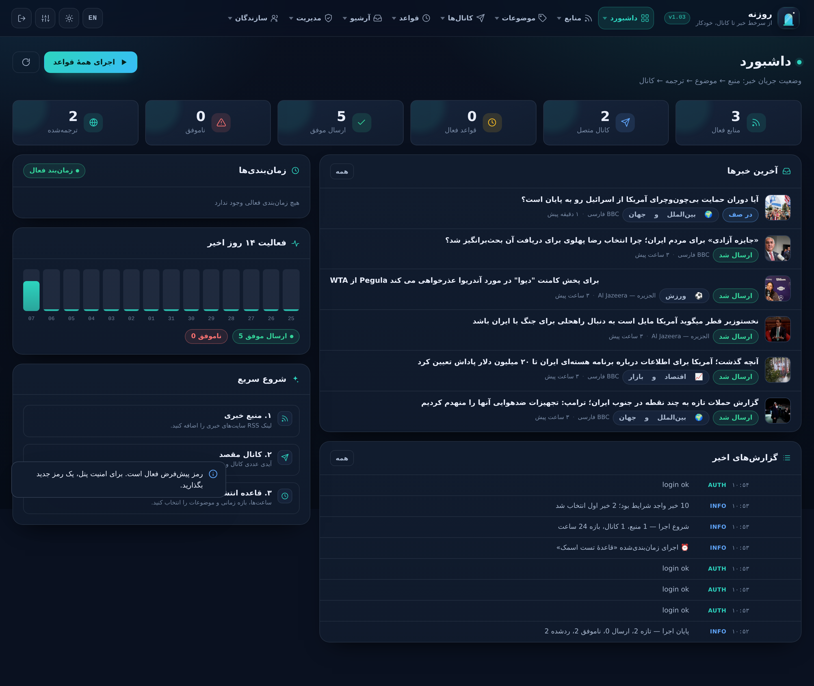 | 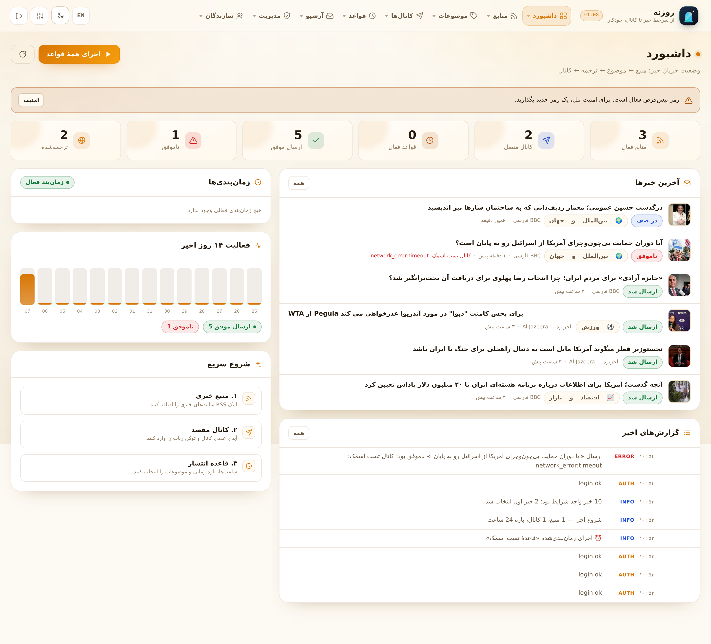 |

| منابع خبری | قواعد انتشار |
| --- | --- |
| 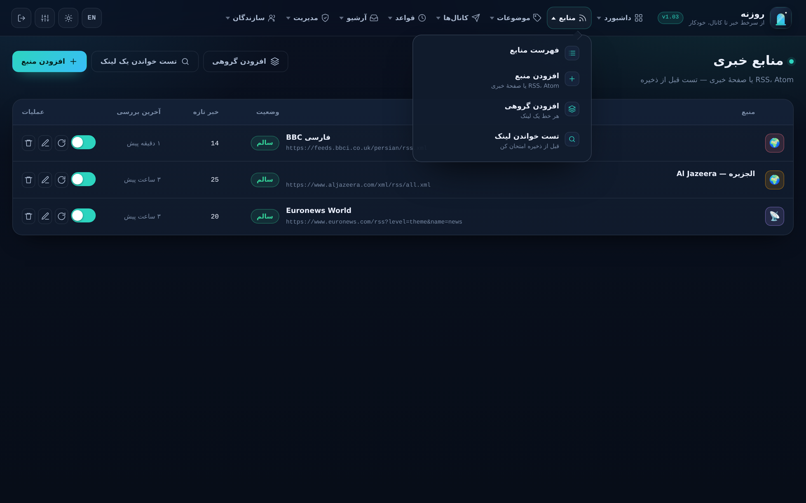 | 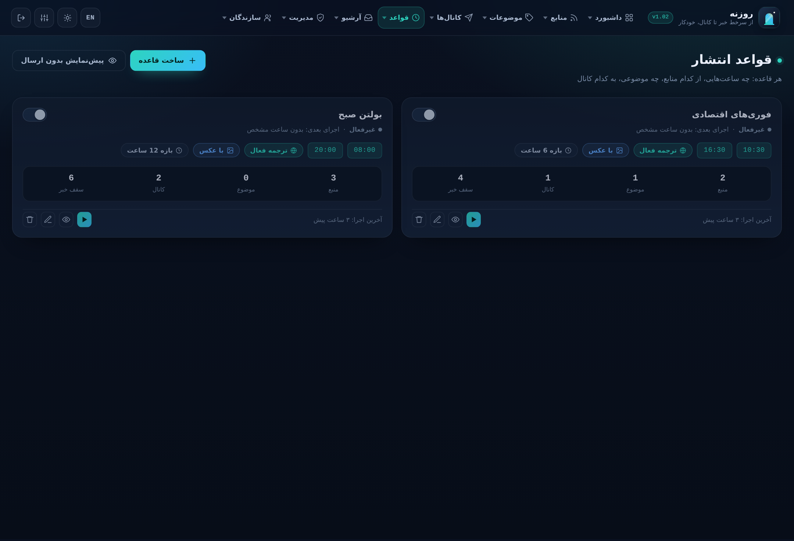 |

| مدیریت — لینک‌ها | رابط انگلیسی |
| --- | --- |
| 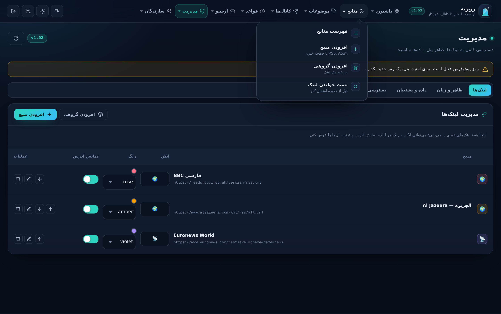 | 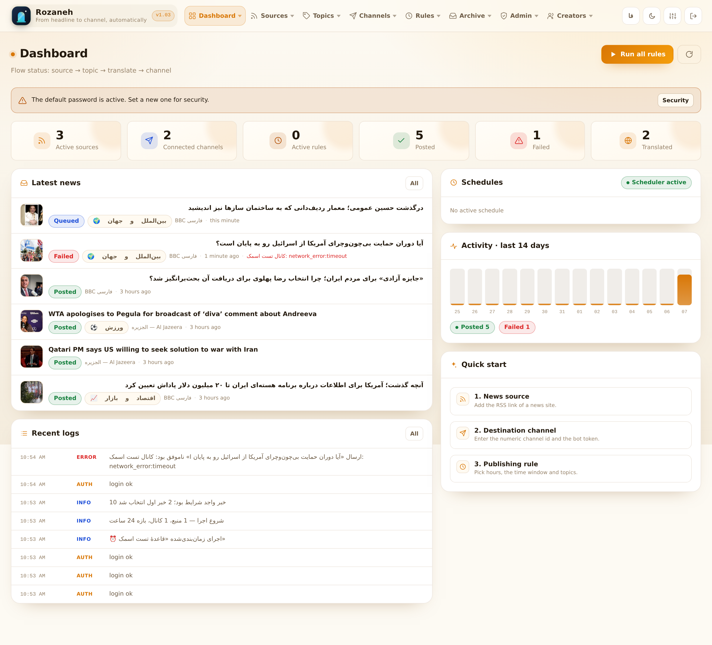 |

| گزارش اجرای آزمایشی | منوی موبایل |
| --- | --- |
| 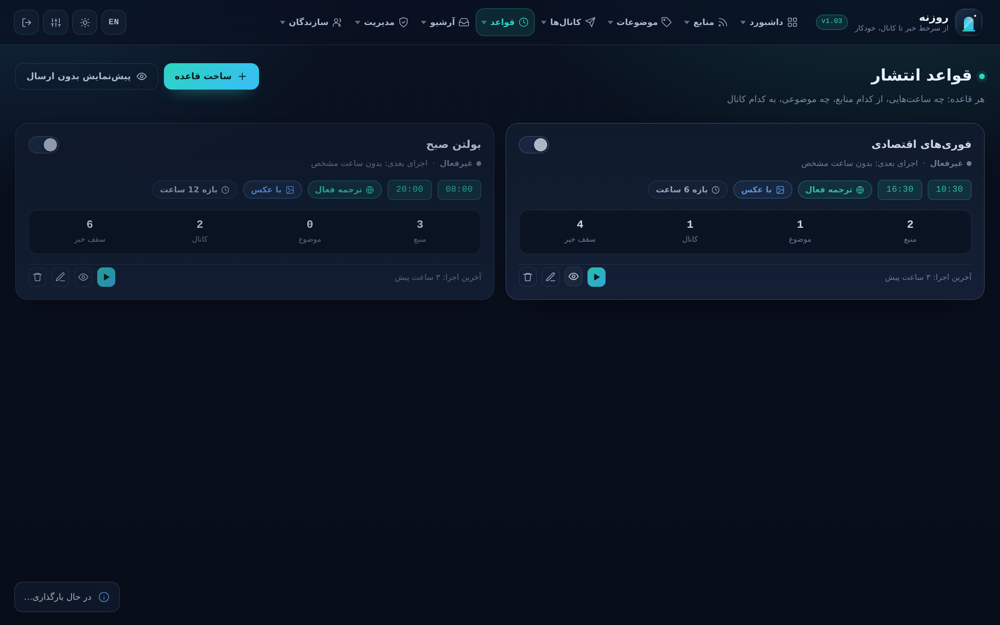 | 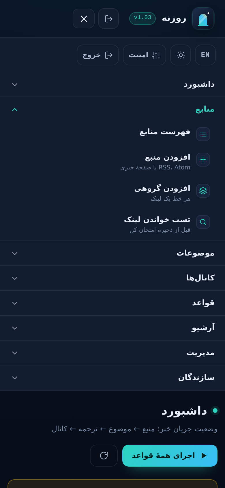 |

| صفحهٔ ورود (اصلاح‌شده در ۱٫۰۲) | قوانین پیام‌رسان در مودال کانال |
| --- | --- |
| 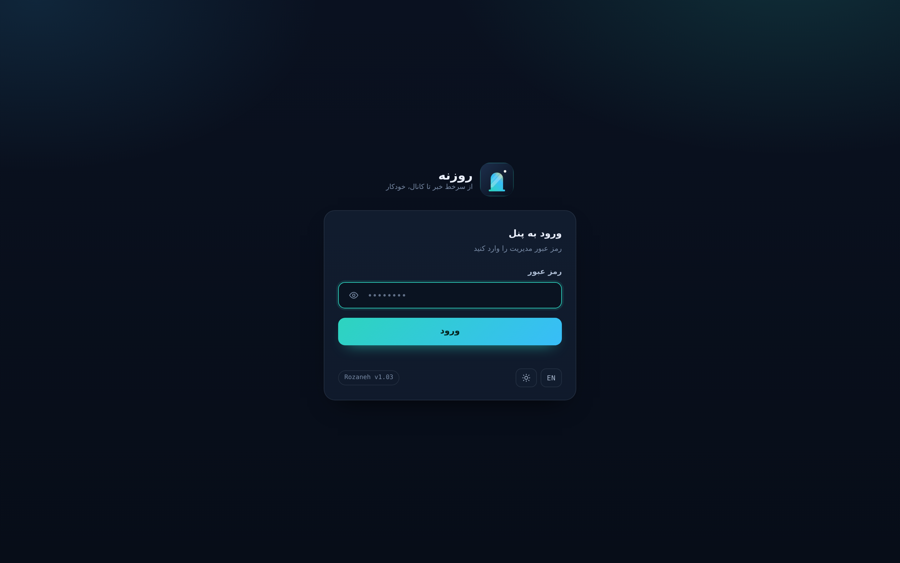 | 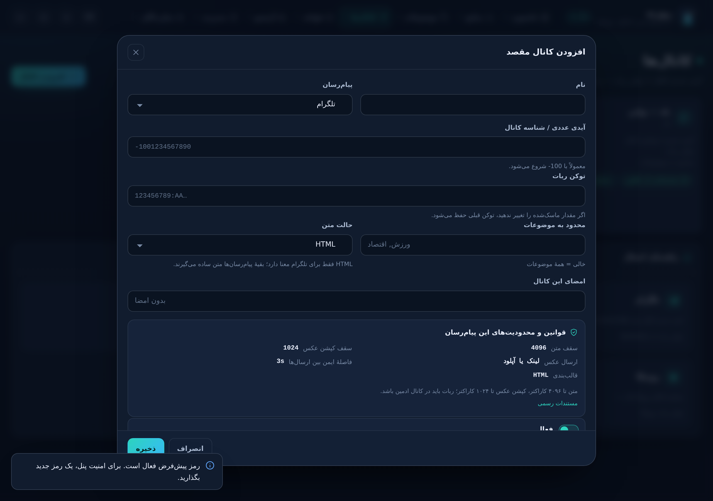 |

| کارت قواعد (بازطراحی ۱٫۰۳) | گزارش اجرا با تشخیص دلیل ارسال‌نشدن |
| --- | --- |
|  | 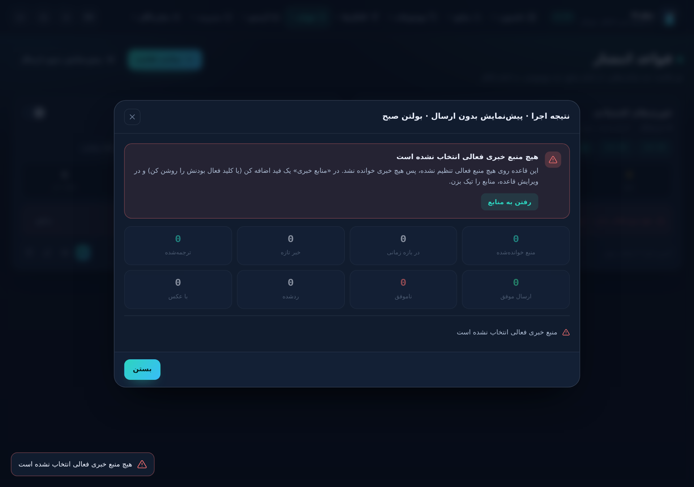 |

تصاویر بیشتر در پوشهٔ [`docs/shots`](docs/shots).

---

## شروع سریع

> گام‌به‌گامِ گیت‌هاب + Railway + تست واقعی کانال و راهنمای Shiprr در [`docs/DEPLOY.md`](docs/DEPLOY.md) آمده است. **Shiprr دیسک دائمی ندارد** و پایگاه SQLite محلی روزنه ممکن است با استقرار مجدد پاک شود؛ برای نگه‌داری داده‌ها میزبانی با دیسک دائمی انتخاب کنید.

### ۱) Railway (پیشنهادی)

1. ریپو را **Fork** کنید.
2. در Railway: `New Project → Deploy from GitHub repo` و همین ریپو را انتخاب کنید.
3. یک **Volume** بسازید و آن را به مسیر `/data` وصل کنید (دیتابیس اینجا می‌ماند).
4. در `Variables` این‌ها را بگذارید:

   | کلید | مقدار نمونه |
   | --- | --- |
   | `DATA_DIR` | `/data` |
   | `ADMIN_PASSWORD` | یک رمز قوی دلخواه |
   | `DEFAULT_TZ` | `Asia/Tehran` |
   | `COOKIE_SECURE` | `1` |

5. `Settings → Networking → Generate Domain` را بزنید و پنل را باز کنید.
6. سلامت سرویس: `GET /healthz` → `{"ok":true,"app":"Rozaneh","version":"1.04"}`

### ۲) Docker

```bash
docker build -t rozaneh .
docker run -d --name rozaneh -p 8080:8080 \
  -v rozaneh-data:/data \
  -e ADMIN_PASSWORD='یک-رمز-قوی' \
  -e DEFAULT_TZ=Asia/Tehran \
  rozaneh
```

### ۳) VPS (Ubuntu/Debian)

```bash
curl -fsSL https://raw.githubusercontent.com/USER/Rozaneh/main/start.sh | sudo bash
```

اسکریپت پایتون را نصب می‌کند، محیط مجازی می‌سازد، سرویس `systemd` می‌سازد و رمز اولیهٔ پنل را چاپ می‌کند.

### ۴) اجرای محلی

```bash
cp .env.example .env
python -m venv .venv && source .venv/bin/activate
pip install -r requirements.txt
uvicorn app.main:app --reload --port 8080
# → http://127.0.0.1:8080
```

رمز اولین ورود همان `ADMIN_PASSWORD` است (پیش‌فرض: `rozaneh`). **بعد از اولین ورود از «تنظیمات → امنیت» رمز را عوض کنید.**

---

## متغیرهای محیطی

| متغیر | پیش‌فرض | توضیح |
| --- | --- | --- |
| `ADMIN_PASSWORD` | `rozaneh` | رمز اولین بوت؛ پس از تغییر در پنل، هش PBKDF2 ذخیره می‌شود. |
| `DATA_DIR` | `./data` | پوشهٔ دیتابیس SQLite (`rozaneh.db`). روی Railway: `/data`. |
| `DEFAULT_TZ` | `Asia/Tehran` | منطقهٔ زمانی زمان‌بند (ساعت‌های قواعد بر همین اساس است). |
| `PORT` | `8080` | پورت HTTP. |
| `COOKIE_SECURE` | `0` | اگر پنل روی HTTPS است، `1` بگذارید. |
| `SCHEDULER_ENABLED` | `1` | `0` = فقط اجرای دستی. |
| `HTTP_TIMEOUT` | `20` | مهلت درخواست‌های خروجی (ثانیه). |
| `SEND_DELAY` | `0.8` | فاصلهٔ بین دو ارسال (ثانیه) برای رعایت محدودیت ربات‌ها. |

کلیدهای ترجمه (`DeepSeek API key` و …) در پنل → تنظیمات → ترجمه ذخیره می‌شوند و در خروجی پشتیبان قرار نمی‌گیرند.

---

## جریان کار

```text
┌────────────┐   ┌──────────────┐   ┌───────────────┐   ┌──────────────┐   ┌─────────────┐
│  منابع RSS │ → │  بازهٔ زمانی  │ → │ فیلتر موضوعی  │ → │ ترجمه EN→FA  │ → │  کانال‌ها    │
│ RSS/Atom/  │   │  (۶ تا ۲۴ س) │   │ وزن کلیدواژه  │   │ DeepSeek +   │   │ ۵ پیام‌رسان  │
│   HTML     │   │              │   │ قبل از سقف    │   │ fallback     │   │ هر خبر ۱ پیام│
└────────────┘   └──────────────┘   └───────────────┘   └──────────────┘   └─────────────┘
                                                                                   │
                                                        آرشیو + گزارش‌ها ←──────────┘
```

فیلتر موضوعی **قبل** از اعمال سقف خبر انجام می‌شود تا سهمیهٔ هر اجرا با خبرهای بی‌ربط پر نشود. هر خبر پیش از ارسال در آرشیو ثبت می‌شود؛ بدون تکرار (`only_unseen`) و با استخراج عکس از خود خبر.

---

## کانال‌ها و پیام‌رسان‌ها

روزنه با API رسمی هر چهار پیام‌رسان حرف می‌زند و **قوانین هر کدام** را رعایت می‌کند:
سقف کاراکتر، کپشن عکس، قالب‌بندی، شکل ارسال تصویر و فاصلهٔ ایمن بین پیام‌ها.

| پیام‌رسان | Endpoint | سقف متن | سقف کپشن | قالب‌بندی | تصویر | فاصلهٔ ایمن |
| --- | --- | --- | --- | --- | --- | --- |
| تلگرام | `api.telegram.org/bot<token>/…` | ۴۰۹۶ | ۱۰۲۴ | HTML | آپلود یا URL | ۳ ثانیه |
| بله | `tapi.bale.ai/bot<token>/…` | ۴۰۹۶ | ۴۰۹۶ | متن ساده | آپلود یا URL | ۱٫۵ ثانیه |
| ایتا | `eitaayar.ir/api/<token>/…` | ۴۰۹۶ | ۴۰۹۶ | متن ساده | `sendFile` (آپلود) | ۲ ثانیه |
| روبیکا | `botapi.rubika.ir/v3/<token>/…` | ۴۰۰۰ | ۴۰۰۰ | متن ساده | سه‌مرحله‌ای `requestSendFile` → upload → `sendFile` | ۲ ثانیه |
| وب‌هوک | آدرس خودتان | — | — | JSON | — | — |

نکته‌های عملی:

- **ربات باید در کانال ادمین باشد** (در تلگرام با اجازهٔ «ارسال پیام»)؛ وگرنه خطای `chat not found` / `not enough rights` برمی‌گردد و همان متن در گزارش اجرا و آرشیو ذخیره می‌شود.
- تلگرام عکس را فقط به‌صورت **JPEG** (یا PNG) می‌پذیرد؛ اگر تصویر منبع WebP/AVIF باشد روزنه خودش آن را به JPEG تبدیل می‌کند (حتی‌المقدور ۱۰ مگابایت).
- هر آیتم **یک پیام مستقل** است. اگر متن از سقف بیشتر شود، هوشمندانه کوتاه می‌شود و در حالت عکس، **لینک منبع هرگز قربانی کوتاه‌سازی نمی‌شود**.
- ایتا متد `sendPhoto` ندارد؛ ارسال تصویر با `sendFile` انجام می‌شود. روبیکا آپلود مستقیم ندارد و باید سه مرحله طی شود.
- بله، ایتا و روبیکا `parse_mode` تلگرامی ندارند؛ روزنه برای آن‌ها تگ‌ها را حذف می‌کند تا `<b>` خام در کانال دیده نشود.
- اگر پلتفرم `429` بدهد، روزنه بعد از `retry_after` **یک بار** دوباره تلاش می‌کند و بعد شکست را ثبت می‌کند — هیچ‌وقت موفقیت قلابی گزارش نمی‌شود.
- دو دکمه در صفحهٔ کانال‌ها: **بررسی اتصال** (`/verify`) فقط با `getMe`/`getChat` می‌پرسد توکن و کانال سالم است و چیزی در کانال نمی‌فرستد؛ **تست** (`/test`) یک پیام آزمایشی واقعی می‌فرستد.
- قوانین هر پلتفرم داخل مودال افزودن کانال هم نشان داده می‌شود (`/api/meta` → `platform_rules`).

---

## ترجمه

- سرویس اصلی: **DeepSeek** (`https://api.deepseek.com/v1`, `deepseek-chat`).
- سرویس پشتیبان: `google_free` (بدون کلید) یا هر endpoint سازگار با OpenAI.
- پرامپت ترجمه شامل: ترجمهٔ خبریِ روان، حفظ نام‌ها/سازمان‌ها/اعداد/تاریخ‌ها، پرهیز از واژه‌های نامفهوم، بازنویسی تیتر به سبک خبری، و واژه‌نامهٔ «ترجمه نشوند».
- خروجی پیش از انتشار بازبینی می‌شود (طول، زبان، کلمات ناقص) و در صورت خرابی، دوباره ترجمه یا روی سرویس پشتیبان سوییچ می‌شود.
- همهٔ ترجمه‌ها با `hash` متن مبدأ کش می‌شوند.

---

## ساختار پروژه

```text
rozaneh/
├── app/
│   ├── config.py      # نسخه، تم‌ها، زبان‌ها، پلتفرم‌ها، مسیرها، env
│   ├── db.py          # SQLite (WAL) + مهاجرت + داده‌های اولیه
│   ├── feeds.py       # خواندن RSS/Atom/HTML، تصویر خبر، بازهٔ زمانی
│   ├── topics.py      # امتیازدهی و دسته‌بندی موضوعی
│   ├── translate.py   # DeepSeek / OpenAI-compatible / Google + کش
│   ├── publish.py     # آداپترهای ۵ پیام‌رسان + رندر پیام و کپشن
│   ├── pipeline.py    # اجرای قاعده، ارسال مجدد، پیش‌نمایش
│   ├── scheduler.py   # زمان‌بند داخل اپ (asyncio)
│   ├── security.py    # PBKDF2، نشست‌ها، احراز هویت
│   ├── video.py       # تحلیلگر ویدیو (بدون تایم‌اوت): متادیتا، ffmpeg، متن، خلاصه
│   └── main.py        # FastAPI + همهٔ مسیرهای API
├── static/
│   ├── index.html     # پوستهٔ پنل
│   ├── login.html     # صفحهٔ ورود
│   └── assets/        # style.css (دو تم) · i18n.js (فا/EN) · app.js · video.js · logo.svg
├── docs/shots/        # اسکرین‌شات‌ها
├── Dockerfile · railway.toml · start.sh · requirements.txt
└── .github/workflows/ci.yml
```

بک‌اند بدون ORM و بدون build-step فرانت‌اند نوشته شده است: کل پنل با HTML/CSS/JS خالص سرو می‌شود و هیچ CDN یا منبع خارجی لازم ندارد.

---

## API

همهٔ مسیرها زیر `/api` و با کوکی نشست محافظت می‌شوند (به‌جز `/api/meta`, `/api/login`, `/healthz`).

| مسیر | کار |
| --- | --- |
| `GET /api/meta` | نسخه، تم‌ها، زبان‌ها، پلتفرم‌ها، وضعیت ورود |
| `POST /api/login` · `POST /api/logout` | ورود/خروج |
| `GET/PATCH /api/settings` | تنظیمات پنل، ترجمه، انتشار |
| `GET/POST/PATCH/DELETE /api/feeds` | منابع + `bulk` + `reorder` + `test` + `{id}/check` |
| `GET/POST/PATCH/DELETE /api/topics` | موضوعات + `POST /api/topics/test` |
| `GET/POST/PATCH/DELETE /api/destinations` | کانال‌ها + `{id}/test` (ارسال واقعی) + `{id}/verify` (بررسی توکن/کانال) |
| `GET/POST/PATCH/DELETE /api/jobs` | قواعد + `{id}/run` (`dry_run`) + `{id}/logs` |
| `GET /api/items` · `POST /api/items/{id}/resend` | آرشیو، ارسال مجدد، پیش‌نمایش |
| `GET /api/logs` · `GET /api/dashboard` | گزارش‌ها و آمار |
| `GET /api/admin/overview` · `export` · `POST import` | مدیریت و پشتیبان |
| `POST /api/translate/test` | تست سرویس ترجمه |
| `GET /api/video/status` · `GET/PATCH /api/video/settings` | وضعیت تحلیلگر (ffmpeg، کارهای در حال اجرا) و سوییچ حالت هوشمند |
| `POST /api/video/analyze` | تحلیل دستی/API یک لینک — `wait:true` تا پایان منتظر می‌ماند (بدون تایم‌اوت)، وگرنه `job_id` پس می‌دهد |
| `POST /api/video/upload` | تحلیل فایل آپلودی (بدنهٔ خام، `?filename=clip.mp4`) |
| `GET /api/video/jobs/{id}` · `GET /api/video/analyses` · `cancel` · `DELETE` | گزارش تحلیل، تاریخچه، لغو و حذف |
| `GET /healthz` | سلامت سرویس |

مستندات تعاملی: `/api/docs`.

---

## امنیت

- رمز عبور با **PBKDF2-HMAC-SHA256** (۲۴۰٬۰۰۰ دور، salt تصادفی) ذخیره می‌شود.
- نشست‌ها در دیتابیس با انقضای ۷ روزه؛ کوکی `HttpOnly` + `SameSite=Lax` (+ `Secure` روی HTTPS).
- تا زمانی که رمز پیش‌فرض تغییر نکرده باشد، در داشبورد و بخش مدیریت هشدار نمایش داده می‌شود.
- توکن ربات‌ها هرگز کامل به فرانت‌اند نمی‌رود (ماسک‌شده) و در خروجی پشتیبانِ پیش‌فرض قرار نمی‌گیرد.
- می‌توانید همهٔ نشست‌های دیگر را از «مدیریت → دسترسی» ببندید.

---

## نسخه‌گذاری

نسخه در `app/config.py` نگه‌داری می‌شود:

```python
VERSION = "1.04"
VERSION_STEP = 0.01
```

قاعده: **هر انتشار، یک‌صدم اضافه می‌کند** — `1.02`, `1.04`, … عدد نسخه در `/api/meta`, `/api/runtime`, `/api/admin/overview`, `/healthz` و نشان بالای پنل دیده می‌شود.

---

## توسعه

```bash
python -m compileall -q app main.py      # بررسی سینتکس
node --check static/assets/app.js        # بررسی جاوااسکریپت
uvicorn app.main:app --reload            # اجرا
```

CI (`.github/workflows/ci.yml`) در هر push: کامپایل، ایمپورت اپ، بررسی وجود مسیرهای اصلی و تست منطق زمان‌بند را اجرا می‌کند.

دو تست مرورگری (نیاز به `pip install playwright && playwright install chromium`) در مخزن هست:

```bash
python docs/smoke_ui.py                    # ۲۶ بررسی سرتاسری: ساخت/ویرایش/حذف، قوانین کانال، گزارش اجرا
python docs/login_check.py --engines all   # صفحهٔ ورود در ۳ موتور × ۷ عرض × دو جهت (RTL/LTR)
python docs/verify_panel.py                # اسکرین‌شات همهٔ صفحات + کنترل سرریز افقی + خطاهای کنسول
```

---

## تغییرات

| نسخه | تغییرات |
| --- | --- |
| **1.04** | **تحلیلگر ویدیو** با تحلیل واقعی (متادیتا، ffprobe/MP4، فریم با ffmpeg، متن، خلاصهٔ LLM) و **بدون هیچ محدودیت زمانی**، به‌همراه **حالت دستی** و **سوییچ حالت هوشمند**؛ حذف بخش‌های تکراری (ویرایش آیکن/رنگ/نمایش آدرس از تب «لینک‌ها» حذف شد و فقط در مودال منبع ماند، تنظیمات عمومی از تب «ظاهر» حذف و به صفحهٔ تنظیمات ارجاع شد)، لایهٔ ظاهری حرفه‌ای‌تر، و رفع باگ‌ها: نشت توکن ربات در فایل پشتیبان، بازنویسی‌نشدن توکن پنهان در بازیابی، `max_items=0` که به ۸ برمی‌گشت، کد خطای گزارش زمان‌بند، و پارسر MP4/ffprobe. |
| 1.03 | بازطراحی خوانایی: تایپوگرافی و فاصله‌های بزرگ‌تر، کارت قواعد تازه (وضعیت، زمان‌ها، چهار سنجه، هشدار «بی‌منبع/بی‌کانال» با دکمهٔ میان‌بر)، منوهای کشویی که واقعاً با هاور باز می‌شوند، سوییچ‌های واضح، کاشی‌های آمار بازچینی‌شده، و **تشخیص دقیق دلیل ارسال‌نشدن** در گزارش اجرا (منبع فعال نیست / کانال فعال نیست / هیچ خبری با موضوع‌ها جور نشد). |
| 1.02 | رفع باگ چیدمان صفحهٔ ورود (جای آیکن چشم، دکمهٔ تمام‌عرض «ورود»، چیپ‌های زبان/تم در عرض کم)، فایل‌های CSS/JS با نسخه (`?v=1.02`) تا کش قدیمی چیدمان را نشکند، **بازنویسی کامل لایهٔ ارسال**: قوانین واقعی تلگرام/بله/ایتا/روبیکا، آپلود و تبدیل تصویر (WebP→JPEG)، حذف تگ‌ها برای پیام‌رسان‌های بدون HTML، تلاش مجدد روی `429`، فاصلهٔ ایمن بین ارسال‌ها، دکمه/اندپوینت **بررسی اتصال**، نمایش قوانین هر پلتفرم در مودال کانال. |
| 1.01 | نسخهٔ کامل پنل: منابع، موضوعات، ترجمه، انتشار به کانال، آرشیو، تنظیمات، مدیریت، دو تم، دو زبان، داکر/Railway/VPS. |

---

## English summary

**Rozaneh** is a deploy-ready newsroom panel: it reads RSS/Atom feeds (or plain news pages) on a schedule, filters items by topic keywords, translates them into fluent Persian (DeepSeek with automatic fallback) and publishes **each item as its own message, together with its image**, to Telegram, Bale, Eitaa, Rubika or your own webhook.

Highlights:

- Bilingual panel (Persian RTL / English LTR) with two themes — *Slate* (dark) and *Amber & White*.
- Per-link appearance control (icon, colour, URL visibility, order), bulk add and link testing.
- Topic engine with weighted keyword matching and 10 bilingual presets.
- Publishing rules with multiple daily hours or an interval, a news window, per-run cap, source/topic/channel selection, dry runs and full run reports.
- Archive with delivery status, previews and one-click resend; JSON export/restore; session management.
- Single Python service + static SPA — no build step, no CDN, no external assets.
- Deploys on Railway (Dockerfile + volume at `/data`), Docker, or a bare Ubuntu VPS via `start.sh`.

Version **1.04** — every release adds `0.01`.

MIT licensed.

---

## مجوز

MIT — فایل [LICENSE](LICENSE).
